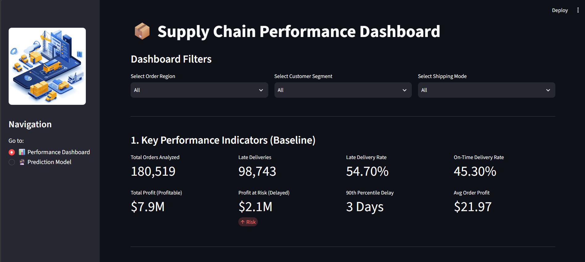
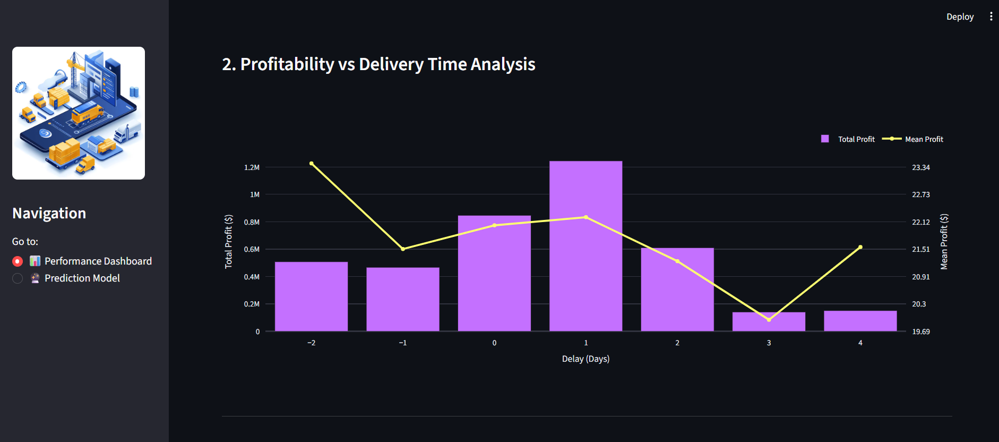
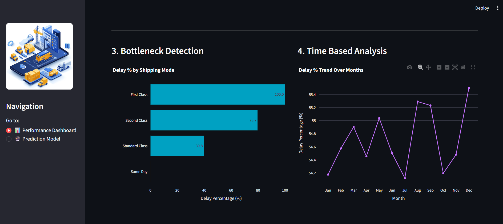
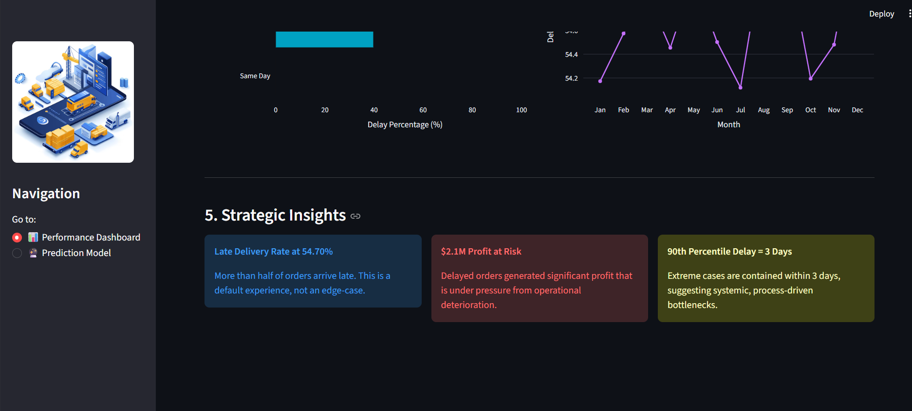
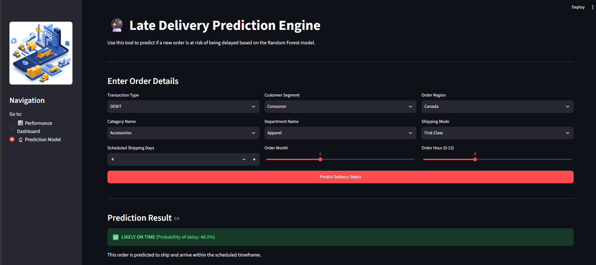

# 📦 Supply Chain Intelligence System

### Predict late deliveries before they happen, and protect the profit at stake.


---

## 📑 Table of Contents

1. [Project Overview](#-project-overview)
2. [Data Science Workflow](#-data-science-workflow)
3. [Dashboard Features](#-dashboard-features)
4. [Project Structure](#-project-structure)
5. [Installation & Setup](#%EF%B8%8F-installation--setup)
6. [Visual Showcase](#-visual-showcase)

---

## 🎯 Project Overview

Late deliveries are one of the most expensive and most visible failures in any supply chain. This project analyzes **over 172,000 historical orders** to uncover why shipments run late and to act on it before customers feel the impact.

| Metric | Value |
|---|---|
| 📬 Historical orders analyzed | **172,000+** |
| ⏱️ Baseline late delivery rate | **54.70%** |
| 💸 Profit at risk from delayed orders | **$2.1M** |
| 🤖 Predictive model | **Random Forest Classifier** |
| 🎯 Model accuracy | **74%** |

**The solution:** an end-to-end analytics and machine learning system that combines

- 📊 an **interactive performance dashboard** that surfaces KPIs, bottlenecks and trends, and
- 🔮 a **real-time prediction engine** that flags at-risk orders *before* they ship, powered by a Random Forest model with **74% accuracy**.

---

## 🔬 Data Science Workflow

```
Raw Data → Cleaning → Feature Engineering → SMOTE Balancing → Model Tuning → Serialization → Streamlit Deployment
```

### 🧹 1. Data Cleaning
- Removed **data leakage columns**, meaning features only known *after* an order is fulfilled, such as **actual shipping days** and **delivery status**.
- This keeps the model honest: it learns only from information available **at the time an order is placed**, so its predictions hold up in production.

### 🛠️ 2. Feature Engineering
- Applied **Frequency Encoding** to **high-cardinality categorical variables**.
- This avoids the dimensionality explosion of one-hot encoding while preserving how common each category is.

### ⚖️ 3. Class Balancing
- Applied **SMOTE** (Synthetic Minority Over-sampling Technique) to balance the target variable, **`is_delayed`**.
- This prevents the model from favoring the majority class and improves its ability to detect genuinely at-risk orders.

### 🎛️ 4. Model Tuning
- Trained a **Random Forest Classifier** and optimized its hyperparameters with **`RandomizedSearchCV`**.
- Randomized search explores a wide hyperparameter space efficiently, balancing performance against training time.

### 🚀 5. Deployment
- Serialized the final tuned model to **`rf_model_balanced.pkl`**.
- Deployed it through an interactive **Streamlit** application for real-time predictions.

---

## 📊 Dashboard Features

The Streamlit app has **two pages**, switchable from the sidebar navigation.

### 📈 Page 1: Performance Dashboard

Global filters for **Order Region**, **Customer Segment** and **Shipping Mode** let you slice every metric on the page.

| Section | Description |
|---|---|
| **1. Key Performance Indicators** | Total orders analyzed, late deliveries, late delivery rate, on-time delivery rate, total profit, profit at risk, 90th percentile delay and average order profit. |
| **2. Profitability vs Delivery Time** | A **dual-axis chart** comparing *total profit* (bars) with *mean profit* (line) across delivery delay in days. It shows how much value sits in on-time, early and late orders. |
| **3. Bottleneck Detection** | **Bar charts of delay percentage by shipping mode**, which pinpoint where the process breaks down. |
| **4. Time-Based Analysis** | **Monthly trend** of delay percentage, useful for spotting seasonality and operational drift. |
| **5. Strategic Insights** | Executive callouts that translate the numbers into action. |

#### 💡 Key Strategic Insights
- 🔵 **Late delivery rate is 54.70%.** More than half of orders arrive late. This is the default experience, not an edge case.
- 🔴 **$2.1M of profit is at risk.** Delayed orders carry significant profit that is under pressure from operational deterioration.
- 🟡 **The 90th percentile delay is 3 days.** Extreme cases are contained within 3 days, which points to **systemic, process-driven bottlenecks** rather than random outliers.

### 🔮 Page 2: Prediction Engine

A clean, form-based interface for scoring a **new order** with the trained Random Forest model.

**Users enter:**
- Transaction Type
- Customer Segment
- Order Region
- Category Name
- Department Name
- Shipping Mode
- Scheduled Shipping Days
- Order Month
- Order Hour (0–23)

**Users receive:**
- ⚡ A **real-time delay risk probability**
- ✅ / 🚨 A clear **on-time vs at-risk verdict**
- 📋 **Fulfillment recommendations** so teams can intervene proactively

---

## 📁 Project Structure

```
Supply-Chain-Intelligence-System/
│
├── 📂 Raw_Data/
│   └── SupplyChainData.csv                  # Source dataset (Git LFS)
│
├── 📂 Data_Modeling_&_Model_Training/
│   └── <your_notebook>.ipynb                # Cleaning, feature engineering, SMOTE, tuning
│
├── 📂 Prediction_App_&_Dashboard/
│   ├── app.py                               # Streamlit application (2 pages)
│   ├── requirements.txt                     # Python dependencies
│   └── rf_model_balanced.pkl                # Trained Random Forest model (Git LFS)
│
├── 📂 images/
│   └── ...                                  # Dashboard screenshots
│
└── README.md
```

> 📌 **Note:** Large files (`SupplyChainData.csv` and `rf_model_balanced.pkl`) are tracked with **Git LFS**. Make sure Git LFS is installed before cloning.

---

## ⚙️ Installation & Setup

### Prerequisites
- Python 3.9 or higher
- [Git](https://git-scm.com/) and [Git LFS](https://git-lfs.com/)

### 1️⃣ Clone the repository and pull LFS files

```bash
git clone https://github.com/<your-username>/Supply-Chain-Intelligence-System.git
cd Supply-Chain-Intelligence-System
git lfs pull
```

### 2️⃣ Create and activate a virtual environment (`v1`)

**🪟 Windows**
```bash
python -m venv v1
v1\Scripts\activate
```

**🍎 macOS / 🐧 Linux**
```bash
python3 -m venv v1
source v1/bin/activate
```

### 3️⃣ Install dependencies

```bash
cd Prediction_App_&_Dashboard
pip install -r requirements.txt
```

> 💡 If the folder name causes trouble in your shell, wrap it in quotes: `cd "Prediction_App_&_Dashboard"`.

### 4️⃣ Run the app

```bash
streamlit run app.py
```

The app opens automatically at **http://localhost:8501** 🎉

---

## 🖼️ Visual Showcase

### 📊 Performance Dashboard

**Key Performance Indicators**


**Profitability vs Delivery Time Analysis**


**Bottleneck Detection & Time-Based Analysis**


**Strategic Insights**


### 🔮 Prediction Engine



---

## 🧰 Tech Stack

`Python` · `Pandas` · `NumPy` · `Scikit-learn` · `Imbalanced-learn (SMOTE)` · `Plotly` · `Streamlit` · `Git LFS`

---

## 📬 Contact

**Your Name** · [LinkedIn](https://www.linkedin.com/in/mayank-singh-0b6928410/?isSelfProfile=true) · [GitHub](https://github.com/mayanksingh2108)

⭐ If you found this project useful, consider giving it a star!
